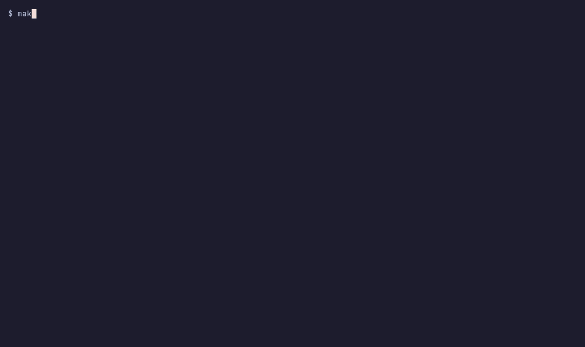
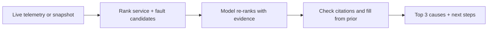

# OTel SRE-Copilot

OTel SRE-Copilot helps on-call engineers rank likely causes of Kubernetes incidents from OpenTelemetry metrics, traces, logs and pod events, with citations checked against the telemetry it queried.



```bash
git clone https://github.com/Wassbdr/otel-sre-copilot && cd otel-sre-copilot
uv venv -p 3.12 && uv pip install -e .
make demo
```

## Key results

<!-- final-comparison:start -->
Astronomy Shop replay: 6 held-out, 12 new untuned development, 14 tuned development snapshots; `nvidia/nemotron-3.5-lightning-30b-a3b` via NVIDIA NIM; 3 runs per Copilot method and 1 per HolmesGPT snapshot; x86_64, 8 vCPU, Linux, no GPU.

Each accuracy cell is strict top-1 / top-3 (service and fault type). Multi-fault runs score the fraction of true causes covered. Grounding and per-run costs are pooled.

| Method | Held-out | New development | Tuned development | Pooled | Grounding | Tokens | Seconds | USD |
| --- | ---: | ---: | ---: | ---: | ---: | ---: | ---: | ---: |
| **SRE-Copilot** | 63.9% / 86.1% | 61.1% / 80.6% | 69.0% / 100.0% | 65.1% / 90.1% | 100.0% | 9,859 | 9.86 | 0.0000 |
| Composite z-score | 50.0% / 58.3% | 16.7% / 50.0% | 28.6% / 50.0% | 28.1% / 51.6% | n/a | 0 | 0.00 | 0.0000 |
| RCAEval N-Sigma (metrics) | 8.3% / 25.0% | 33.3% / 50.0% | 35.7% / 50.0% | 29.7% / 45.3% | n/a | 0 | 0.01 | 0.0000 |
| ReAct without grounding verifier in the agent | 5.6% / 8.3% | 11.1% / 22.2% | 14.3% / 21.4% | 11.5% / 19.3% | 51.7% | 47,489 | 43.12 | 0.0000 |
| HolmesGPT 0.48.0 (1 run per snapshot) | 0.0% / 50.0% | 8.3% / 16.7% | 14.3% / 28.6% | 9.4% / 28.1% | 83.3% | 437,350 | 115.53 | 0.0000 |
| RCAEval BARO (metrics) | 0.0% / 25.0% | 16.7% / 58.3% | 28.6% / 42.9% | 18.8% / 45.3% | n/a | 0 | 0.01 | 0.0000 |
| SRE-Copilot without anomaly prior | 0.0% / 8.3% | 16.7% / 22.2% | 9.5% / 19.0% | 10.4% / 18.2% | 87.8% | 9,056 | 10.41 | 0.0000 |
| Random | 0.0% / 0.0% | 2.8% / 2.8% | 4.8% / 4.8% | 3.1% / 3.1% | n/a | 0 | 0.00 | 0.0000 |
| Error-rate z-score | 0.0% / 0.0% | 0.0% / 8.3% | 0.0% / 14.3% | 0.0% / 9.4% | n/a | 0 | 0.00 | 0.0000 |

RCAEval BARO (metrics) leads on service-only top-3 for new development (83.3% vs. 80.6%); the table uses strict matching.

Seconds exclude rate-limit waits. USD reflects NIM free-tier pricing. Grounding is the share of citations matched to tool calls; n/a means no citations.
<!-- final-comparison:end -->

## How it works



## Details

The demo replays a recorded investigation without an API key or a cluster.
`NIM_API_KEY=... make demo-live` runs the model against the same snapshot.
Without `uv`, create a Python 3.12 virtual environment and install with `.venv/bin/pip install -e .`.

1. **Fault injection.** A scenario YAML holds a Chaos Mesh manifest (pod failure, network delay, HTTP abort, CPU or memory stress) and the expected faulty service. `scripts/inject_and_snapshot.py` applies it, waits for the fault to play out, then records the telemetry of the incident window and an 8-minute pre-incident baseline into `snapshots/<id>/`, with `ground_truth.json`.
2. **Investigation.** Signal fingerprints propose ranked service and fault pairs with observations. With only an incident window, namespace and opaque ID, the agent uses the same tools against live telemetry or a recording. It can reorder the list and propose one new pair with observed evidence.
3. **Verification.** Unsupported hypotheses are removed, and ranked, grounded candidates fill open slots. A separate benchmark scorer checks report citations against tool calls and compares the predicted causes with the recorded ground truth.

Use [your own telemetry](docs/using-your-telemetry.md) with the `copilot` CLI
or Python API, [add a benchmark scenario](docs/adding-a-scenario.md), or
[serve a snapshot over HTTP](docs/reference-tools.md) to compare other tools.

### What is in the box

| Path | What |
|---|---|
| `src/agent/` | LangGraph state machine, tools, prompts, provider-agnostic LLM factory, fake LLM |
| `src/datasources/` | `DataSource` protocol, `LiveDataSource` (Prometheus/Tempo/Loki/K8s HTTP), `ReplayDataSource` |
| `src/demo.py` | Terminal renderer: replay a recorded `trace.json` or run live (`sre-copilot-demo`) |
| `eval/` | scenario runner, metrics, grounding verifier, baselines, `report.py`, `compare.py` |
| `scenarios/mvp/` | 7 Chaos Mesh scenarios |
| `snapshots/` | validated telemetry from the original and expanded capture matrices |
| `artifacts/<run>/` | pinned snapshot manifests and local resumable checkpoints |
| `benchmarks/` | recorded per-run scores, cohort tables and investigation misses |
| `infra/`, `scripts/` | kind config, Helm values, collector config, capture and health scripts |
| `showcase/` | GIF, MP4, poster, `showcase.json`, and `make_showcase.sh` that rebuilds them |

### Scenarios

| # | Service | Fault | Chaos Mesh |
|---|---|---|---|
| 001 | checkout | pod_crash | PodChaos `pod-failure` |
| 002 | product-catalog | high_latency | NetworkChaos delay |
| 003 | payment | http_abort | NetworkChaos packet loss |
| 004 | recommendation | cpu_stress | StressChaos CPU |
| 005 | cart | memory_stress | StressChaos memory |
| 006 | shipping | high_latency | NetworkChaos delay |
| 007 | frontend | pod_crash | PodChaos `pod-failure` |

Each snapshot holds the 6 canonical signals (`error_rate`, `request_rate`, `p99_latency_ms`, `cpu_usage`, `memory_usage`, `pod_restarts`, see `src/telemetry_queries.py`) for 15 services over the incident window and the baseline, Tempo trace summaries and full traces, error logs from Loki, and Kubernetes events. A snapshot is kept only if its validation gate passes: the faulty service must stand out on the expected signal.

### LLM provider

Any OpenAI-compatible chat endpoint with tool calling works. `LLM_*` wins over `NIM_*`, which wins over the built-in default:

| Variable | Fallback | Default |
|---|---|---|
| `LLM_BASE_URL` | `NIM_BASE_URL` | `https://integrate.api.nvidia.com/v1` |
| `LLM_API_KEY` | `NIM_API_KEY` | none (required for live runs) |
| `LLM_MODEL` | `NIM_MODEL` | `nvidia/nemotron-3.5-lightning-30b-a3b` |
| `LLM_PROVIDER=fake` | | deterministic scripted model for tests and offline plumbing |

`meta/llama-3.1-70b-instruct`, the model the project started with, was retired from NIM on 2026-08-26 (HTTP 410). Copy `.env.example` to `.env` to set these.

### Re-running the benchmark

```bash
export NIM_API_KEY=...
make bench BENCH_RUN_ID=my-comparison BENCH_METHODS='agent react agent_no_prior baro nsigma composite_zscore zscore random'
make demo TRACE=artifacts/my-comparison/scenarios/<snapshot>/agent_full/rep0/trace.json
```

Set `HOLMES_PYTHON` to include HolmesGPT; see [reference tools](docs/reference-tools.md).
See [benchmark results](benchmarks/results.md) for iterations, cohort details and scenario misses.
`python -m eval.final_report` rebuilds the comparison from recorded rows without a key.
`bash showcase/make_showcase.sh` also rebuilds the poster and demo media; install
[VHS](https://github.com/charmbracelet/vhs), ttyd and FFmpeg first.

### Capturing new snapshots (live cluster)

Needs Docker with about 8 CPUs and 16 GB RAM, plus `kind`, `kubectl` and `helm` (`make setup`).

```bash
sudo sysctl fs.inotify.max_user_instances=512   # kind + 30 pods exhaust the default
make up && make health-check                    # kind, Chaos Mesh, Astronomy Shop, OTel Collector, Prometheus, Tempo, Loki
make fault SCENARIO=scenarios/mvp/001-checkoutservice-pod-crash.yaml
SEEDS="42 7" scripts/capture_matrix.sh          # all 7 scenarios × 2 seeds, about 12 min each
make investigate INCIDENT_ID=inc-1 START=<iso8601> END=<iso8601>   # live agent on the cluster
```

### Development

```bash
pip install -e ".[dev]"
make test     # pytest, includes a full agent graph run with the fake LLM
make lint     # ruff + mypy --strict
```

CI (`.github/workflows/ci.yml`) runs lint, types, tests, the offline demo, a baseline reproducibility check against the committed run, and an end-to-end replay with the fake LLM.

### License

MIT, see [LICENSE](LICENSE). Telemetry in `snapshots/` comes from the [OpenTelemetry Astronomy Shop demo](https://github.com/open-telemetry/opentelemetry-demo) (Apache-2.0) running on a local kind cluster; it contains no personal or company data.

## Roadmap and known limitations

- **One application and one model.** Iterations 4 through 6 tuned the system on the original development cohort. No changes were tuned on the new development or held-out cohorts. The held-out set includes two-fault incidents.
- **Replay cannot answer arbitrary queries.** The benchmark uses recorded queries and sampled traces. HolmesGPT used the same telemetry and NIM model, with one run per snapshot and ten model steps. Unsupported queries can still return no evidence. Live mode was not benchmarked.
- **Two references could not be scored on matched inputs.** k8sgpt's Pod analyzer needs Kubernetes API resource state; the snapshots hold events, not a Kubernetes API. OpenRCA needs a dataset, prompt and output adapter. See [reference tools](docs/reference-tools.md).
- **Grounding checks citations, not interpretation.** A correct query can still support a wrong diagnosis. Reports with no citations contribute nothing to the grounding denominator.
- **Roadmap.** Test on independent applications and models, add replay adapters for more references, and measure live investigations.
