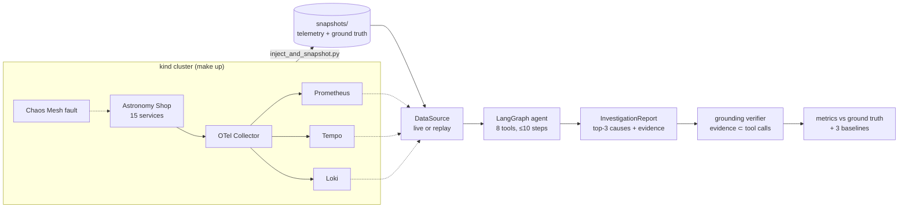

# OTel SRE-Copilot

An LLM agent that finds the root cause of a Kubernetes incident from OpenTelemetry metrics, traces, logs and pod events, with every cited piece of evidence checked against the queries it really ran: for SREs evaluating AI incident triage, and for engineers who want an honest benchmark harness for it.


```bash
git clone https://github.com/Wassbdr/otel-sre-copilot && cd otel-sre-copilot
uv venv -p 3.12 && uv pip install -e .   # or: python3.12 -m venv .venv && .venv/bin/pip install -e .
make demo                 # replays a recorded investigation: no API key, no cluster
```

`NIM_API_KEY=… make demo-live` runs the agent live on the same recorded telemetry (free [NVIDIA NIM](https://build.nvidia.com) key, or any OpenAI-compatible endpoint, see [LLM provider](#llm-provider)). `docker build -t otel-sre-copilot . && docker run --rm -it otel-sre-copilot` does the replay without a local Python.

## Key results

<!-- benchmark:start (written by python -m eval.report) -->
| Method | Top-1 | Top-3 | Service top-1 / top-3 | Grounding | Latency / incident | Tokens / incident |
|---|---|---|---|---|---|---|
| **SRE-Copilot agent (LLM)** | 36% ± 12 | 48% ± 7 | 62% / 86% | 0.97 | 54.8 s | 85,770 |
| Composite z-score (5 signals) | 29% | 50% | 43% / 93% | n/a | 0 ms | 0 |
| Z-score on error_rate | 0% | 14% | 14% / 50% | n/a | 0 ms | 0 |
| Random | 0% | 0% | 0% / 29% | n/a | 0 ms | 0 |

<sub>14 replayed Chaos Mesh snapshots (7 scenarios × seeds 42, 7) of the OpenTelemetry Astronomy Shop; agent = `nvidia/nemotron-3.5-lightning-30b-a3b` via NVIDIA NIM, temperature 0, 3 runs per snapshot; baseline RANDOM_SEED=42; x86_64 8 vCPU, Linux, no GPU. Run `bench-20261127b`, full tables in [results/benchmark.md](results/benchmark.md).</sub>
<!-- benchmark:end -->

Agent rows are means over 3 runs per snapshot (± = standard deviation across runs). Baselines are deterministic. Regenerate with `make benchmark` (needs a key) or re-report the committed run with `bash showcase/make_showcase.sh`.

## How it works



1. **Fault injection.** A scenario YAML holds a Chaos Mesh manifest (pod failure, network delay, HTTP abort, CPU or memory stress) and the expected faulty service. `scripts/inject_and_snapshot.py` applies it, waits for the fault to play out, then records the telemetry of the incident window and an 8-minute pre-incident baseline into `snapshots/<id>/`, with `ground_truth.json`.
2. **Investigation.** The agent gets only an opaque incident id, a namespace and a time window. It calls tools (`rank_services_by_signal`, `query_prometheus_range`, `search_traces`, `get_trace`, `query_loki`, `get_pod_events`, `get_service_topology`, …) through a `DataSource` that talks to the live backends or replays a snapshot, then writes a Pydantic `InvestigationReport`: three ranked hypotheses (service + fault type), evidence, remediation.
3. **Verification.** The harness, not the agent, scores the report: top-1 / top-3 / MRR against Chaos Mesh ground truth, and a grounding score, the share of cited evidence (PromQL, LogQL, trace id, pod event) that matches a tool call made during the run. Below 0.8 the run is flagged `[HALLUCINATION WARNING]`.
4. **Baselines.** Random, a Z-score on error rate, and a composite Z-score over five signals run on the same snapshots.

## Details

### What is in the box

| Path | What |
|---|---|
| `src/agent/` | LangGraph state machine, tools, prompts, provider-agnostic LLM factory, fake LLM |
| `src/datasources/` | `DataSource` protocol, `LiveDataSource` (Prometheus/Tempo/Loki/K8s HTTP), `ReplayDataSource` |
| `src/demo.py` | Terminal renderer: replay a recorded `trace.json` or run live (`sre-copilot-demo`) |
| `eval/` | scenario runner, metrics, grounding verifier, baselines, `report.py`, `compare.py` |
| `scenarios/mvp/` | 7 Chaos Mesh scenarios |
| `snapshots/` | recorded telemetry, 7 scenarios × 2 Chaos Mesh seeds, committed in full |
| `artifacts/<run>/` | raw per-run results and one `trace.json` per agent investigation |
| `results/` | `summary.json`, `benchmark.md`, `baseline_comparison.md` of the committed run |
| `infra/`, `scripts/` | kind config, Helm values, collector config, capture and health scripts |
| `showcase/` | GIF, MP4, poster, `showcase.json`, and `make_showcase.sh` that rebuilds them |

### Scenarios

| # | Service | Fault | Chaos Mesh |
|---|---|---|---|
| 001 | checkout | pod_crash | PodChaos `pod-failure` |
| 002 | product-catalog | high_latency | NetworkChaos delay |
| 003 | payment | http_abort | NetworkChaos packet loss |
| 004 | recommendation | cpu_stress | StressChaos CPU |
| 005 | cart | memory_stress | StressChaos memory |
| 006 | shipping | high_latency | NetworkChaos delay |
| 007 | frontend | pod_crash | PodChaos `pod-failure` |

Each snapshot holds the 6 canonical signals (`error_rate`, `request_rate`, `p99_latency_ms`, `cpu_usage`, `memory_usage`, `pod_restarts`, see `src/telemetry_queries.py`) for 15 services over the incident window and the baseline, Tempo trace summaries and full traces, error logs from Loki, and Kubernetes events. A snapshot is kept only if its validation gate passes: the faulty service must stand out on the expected signal.

### LLM provider

Any OpenAI-compatible chat endpoint with tool calling works. `LLM_*` wins over `NIM_*`, which wins over the built-in default:

| Variable | Fallback | Default |
|---|---|---|
| `LLM_BASE_URL` | `NIM_BASE_URL` | `https://integrate.api.nvidia.com/v1` |
| `LLM_API_KEY` | `NIM_API_KEY` | none (required for live runs) |
| `LLM_MODEL` | `NIM_MODEL` | `nvidia/nemotron-3.5-lightning-30b-a3b` |
| `LLM_PROVIDER=fake` | | deterministic scripted model for tests and offline plumbing |

`meta/llama-3.1-70b-instruct`, the model the project started with, was retired from NIM on 2026-08-26 (HTTP 410). Copy `.env.example` to `.env` to set these.

### Re-running the benchmark

```bash
export NIM_API_KEY=...               # or LLM_BASE_URL / LLM_API_KEY / LLM_MODEL
make benchmark                       # agent × 3 + 3 baselines on every snapshot → artifacts/, results/
make demo TRACE=artifacts/<run>/scenarios/<snapshot>/rep0/trace.json   # replay any investigation
```

`make eval-baselines` re-runs only the baselines (seconds, no key). `bash showcase/make_showcase.sh` checks the baselines reproduce the committed run exactly, then rebuilds `results/`, the poster, `showcase.json` and, if [vhs](https://github.com/charmbracelet/vhs) is installed, the GIF and MP4.

### Capturing new snapshots (live cluster)

Needs Docker with about 8 CPUs and 16 GB RAM, plus `kind`, `kubectl` and `helm` (`make setup`).

```bash
sudo sysctl fs.inotify.max_user_instances=512   # kind + 30 pods exhaust the default
make up && make health-check                    # kind, Chaos Mesh, Astronomy Shop, OTel Collector, Prometheus, Tempo, Loki
make fault SCENARIO=scenarios/mvp/001-checkoutservice-pod-crash.yaml
SEEDS="42 7" scripts/capture_matrix.sh          # all 7 scenarios × 2 seeds, about 12 min each
make investigate INCIDENT_ID=inc-1 START=<iso8601> END=<iso8601>   # live agent on the cluster
```

### Development

```bash
pip install -e ".[dev]"
make test     # pytest, includes a full agent graph run with the fake LLM
make lint     # ruff + mypy --strict
```

CI (`.github/workflows/ci.yml`) runs lint, types, tests, the offline demo, a baseline reproducibility check against the committed run, and an end-to-end replay with the fake LLM.

## Roadmap and known limitations

- **Small benchmark.** 14 snapshots (7 scenarios × 2 seeds) of a single application. Percentages move by 7 points per snapshot; read them as indicative.
- **The agent shares the baseline's statistic.** `rank_services_by_signal` exposes the composite Z-score per signal as a tool. What the LLM adds is reasoning over topology, traces, logs and events, and it can do worse than the baseline when it over-weights a symptom.
- **One prompt adjustment was made after a development run** on `checkout-pod_crash-seed42` (the entry-point-symptom hint). That snapshot is part of the benchmark.
- **Replay answers only recorded queries.** Free-form PromQL that the capture did not record returns no data; the prompt lists the exact queries available. Live mode has no such limit but was not benchmarked.
- **Grounding checks citation, not interpretation.** A run that cites a real query but misreads it still scores 1.0, and a report with no evidence scores 1.0 too.
- **Baseline windows.** Snapshots keep 8 minutes of pre-incident data and scenarios were captured 6 minutes apart, so a baseline can include the tail of the previous scenario's recovery.
- **Roadmap.** More seeds and the 35-scenario set (`scenarios/full`), multi-fault incidents, a benchmarked live mode, and a comparison across several open models.

## License

MIT, see [LICENSE](LICENSE). Telemetry in `snapshots/` comes from the [OpenTelemetry Astronomy Shop demo](https://github.com/open-telemetry/opentelemetry-demo) (Apache-2.0) running on a local kind cluster; it contains no personal or company data.
